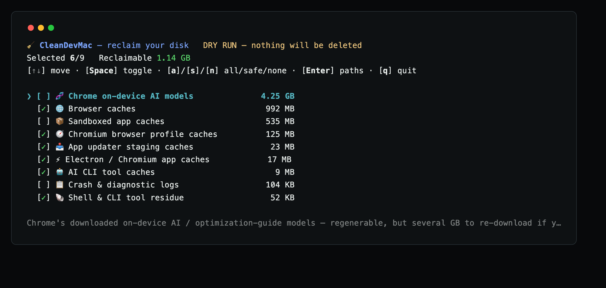

# CleanDevMac

[English](README.md) | [العربية](README.ar.md) | Español | [日本語](README.ja.md) | [简体中文](README.zh-CN.md) | [繁體中文](README.zh-TW.md)

[](https://github.com/cleandevmac/cdm/releases)
[](https://github.com/cleandevmac/cdm/releases/latest)
[](https://github.com/cleandevmac/cdm/stargazers)
[](LICENSE)
[](https://github.com/cleandevmac/cdm)
[](https://www.paypal.com/paypalme/hoangnc)

**CleanDevMac** — `cdm` en tu línea de comandos — es una interfaz de terminal que encuentra las cachés de desarrollo, los artefactos de compilación y los restos de datos de aplicaciones que se están comiendo tu disco, te muestra exactamente qué son y cuánto ocupan, y borra solo lo que tú marques.

La insignia de descargas cuenta las peticiones al recurso de release `cdm`. Cada `curl` de aquí abajo llega a ese recurso, así que es el contador real de uso de esta herramienta.

Sitio: **<https://cleandevmac.github.io>**

Solo para macOS. Bash puro, sin dependencias. Cero telemetría: la única llamada de red que hace `cdm` es la descarga de su propio JSON de reglas. (Pulsar `b` después de una limpieza abre el enlace de donación en tu navegador; nunca se envía nada.)

## Ejecútalo

```bash
curl -sSL https://github.com/cleandevmac/cdm/releases/latest/download/cdm | bash
```

No hay paso de instalación. El script se ejecuta directamente desde la tubería, escanea y te entrega la TUI. Cuando termina, no deja nada suyo en tu Mac.

Prueba primero en seco: escanea e informa, no borra nada.

```bash
curl -sSL https://github.com/cleandevmac/cdm/releases/latest/download/cdm | bash -s -- -n
```

### Todas las cuentas de este Mac

Con `sudo`, `cdm` se ejecuta una vez por cada cuenta de usuario del Mac, una tras otra:

```bash
curl -sSL https://github.com/cleandevmac/cdm/releases/latest/download/cdm | sudo bash
```

Cada cuenta la escanea y la limpia su propio usuario, nunca root, con la misma revisión y confirmación que una ejecución normal. Si hay más de una cuenta, pregunta antes de cada una: Enter para escanear, `s` para saltarla, `q` para parar. Las opciones como `-n` se aplican a todas las cuentas, y Ctrl-C detiene toda la ejecución. Para limpiar solo algunas cuentas, nómbralas con `--user` (repítelo para más):

```bash
curl -sSL https://github.com/cleandevmac/cdm/releases/latest/download/cdm | sudo bash -s -- --user tham
```

## Consérvalo (opcional)

Haz esto solo si quieres volver a ejecutar `cdm` sin la URL. Es lo único de aquí que sí deja un archivo:

```bash
mkdir -p ~/.local/bin
curl -sSL https://github.com/cleandevmac/cdm/releases/latest/download/cdm -o ~/.local/bin/cdm
chmod +x ~/.local/bin/cdm
cdm
```

Asegúrate de que `~/.local/bin` esté en tu `PATH` (`export PATH="$HOME/.local/bin:$PATH"` en el rc de tu shell). Vuelve a ejecutar la línea `curl -o` para actualizar. Para desinstalar: `rm ~/.local/bin/cdm`.



## Qué limpia

**1. Cachés de desarrollo y artefactos de compilación** — DerivedData y DeviceSupport de Xcode, caché de compilación y de módulos de Go, npm/npx/pnpm/yarn, herramientas de build de JS (Turbo, Vite, webpack, Parcel, ESLint), Gradle, Maven, sbt/Ivy, Cargo, Python (pip, uv, poetry, ruff, mypy), Ruby/Bundler, Bun, Deno, CocoaPods, SwiftPM, Composer, Bazel, Zig, CLIs de nube (kubectl, AWS, gcloud, Azure), Docker buildx, JetBrains, Playwright, las cachés de descargas de Homebrew y PlatformIO, las cachés de Android Studio y las instantáneas del emulador, y las imágenes de sistema de Android que ya no usa ningún AVD.

**2. Piezas de SDK instaladas que se vuelven a descargar** — todas opcionales, y cada fila dice cómo vuelven: las plataformas y toolchains instalados de PlatformIO (el siguiente `pio run` descarga lo que necesite); el NDK de Android, CMake y las fuentes del SDK; todas las versiones de build-tools y plataformas de Android salvo la más reciente; la imagen de sistema de un AVD que nadie ha arrancado en 60 días (la fila nombra el AVD, que no arrancará hasta reinstalar la imagen); y cada toolchain de Rust que no sea tu predeterminado ni stable, que se quita con `rustup toolchain uninstall` (la fila nombra cualquier repositorio que lo fije). `sdkmanager`, `adb`, el emulador y el propio `pio` de PlatformIO nunca se ofrecen.

**3. Transcripciones antiguas de Claude Code** — opcional: las sesiones sin tocar en 30 días, con sus archivos de subagentes y salidas de herramientas, van a la Papelera. Las sesiones en curso, la memoria automática y la configuración nunca se tocan. Cuando el historial es grande, `cdm` además imprime la clave de `~/.claude/settings.json` (`desktopSessionCleanupPeriodDays`) con la que Claude Code borra por sí mismo las sesiones antiguas de Desktop y Cowork; `cdm` nunca edita ese archivo.

**4. Cachés de Electron, navegadores y aplicaciones** — VS Code, Claude (incluidas las cachés de webview de cada vista previa y, opcionalmente, la imagen de la VM de Cowork), Slack; Chrome, Brave, Edge, Vivaldi y Arc analizados por perfil de navegador; Firefox; y cachés de SDK de fallos y telemetría (Sentry, Crashlytics, Sparkle).

**5. Basura de proyectos, agrupada por repositorio** — `node_modules`, `dist`, `build`, `target`, `__pycache__` y archivos ignorados por git. Solo lo que el propio repositorio ignora en git. Las ejecuciones interactivas siempre escanean tus repositorios de código; cada fila de proyecto empieza sin marcar. `-y` los omite salvo que pases también `-p`, y aun así nunca los limpia.

**6. Docker / Podman** — `system prune -af`, y `buildx prune -af` sobre la caché de cada builder de buildx (un builder detenido se arranca para ello y se vuelve a detener), opcional. Los volúmenes con nombre nunca se borran.

**7. Datos de aplicaciones huérfanos** — Application Support, Caches y Preferences que pertenecen a aplicaciones que ya no están instaladas, además de las carpetas que algunas aplicaciones guardan con su propio nombre: `~/.vscode` y `Application Support/Code` de VS Code, Cursor, Zed, Docker Desktop, Postman, Slack, los IDE de JetBrains, Android Studio y unas 30 más listadas en `orphans.json`. Las carpetas que también usa una herramienta de línea de comandos (`~/.docker`, `~/.ollama`, `~/.codex`, `~/.android`, `~/.cursor`) y el disco de la VM de Docker Desktop van en una fila aparte **(optional)** que explica cuándo conservarlas, y una carpeta compartida nunca se ofrece mientras un comando que la usa (`docker`, `ollama`, `codex`, `adb`, …) siga en tu PATH.

**Lo que liberaría un reinicio.** El swap, las carpetas temporales que macOS vacía al arrancar y los archivos borrados que una app aún mantiene abiertos no son archivos que ningún limpiador pueda borrar, y en un disco lleno pueden sumar decenas de GB. Cuando superan el espacio libre, `cdm` lo indica bajo la línea del disco, y de nuevo en el menú, y nombra las apps que retienen archivos borrados: cerrarlas libera esa parte sin reiniciar.

## Seguridad

- **No se borra nada sin una confirmación detallada.** Ves el plan y los tamaños, y entonces escribes `y`.
- **Las cachés se borran de forma permanente**: se regeneran en la siguiente compilación.
- **Los datos huérfanos de aplicaciones, los archivos ignorados por git y las transcripciones antiguas de Claude Code van a la Papelera**, así que se pueden recuperar.
- **Todo lo que quita software instalado empieza sin marcar** — piezas de SDK, toolchains, imágenes del emulador — y su fila dice cómo vuelve. Un toolchain de Rust lo quita `rustup`, nunca `rm`.
- **Nunca se tocan, digan lo que digan las reglas:** `~/Documents`, `~/Desktop`, `~/Downloads`, `~/Pictures`, `~/.ssh` y iCloud Drive. Esta protección está por debajo del motor de reglas: una regla no puede saltársela.
- **Una carpeta solo es basura del proyecto si tu repositorio la ignora en git.** Coincidir con un nombre como `dist`, `build` o `Pods` no basta: cdm comprueba con git que el directorio esté ignorado *y* sin seguimiento, así que un `build/` con scripts de publicación bajo control de versiones o un `dist/` confirmado se quedan como están.
- **Los archivos `.env*` nunca se ofrecen para borrar.** El escaneo de proyectos los salta aunque estén ignorados por git: guardan secretos y configuración local que nada regenera.
- **Los sandboxes de aplicaciones y los datos propiedad de Apple o del sistema nunca se tocan.** La única excepción es el contenedor de un Docker Desktop desinstalado, que guarda el disco de su VM; solo se ofrece en una fila (optional) sin marcar.
- La lista de aplicaciones instaladas se lee de **LaunchServices**, así que los prefPanes, plugins y otros paquetes que no son `.app` no se marcan por error como huérfanos. Una aplicación que está en la Papelera, o que LaunchServices da por desaparecida, cuenta como desinstalada.
- **Con `sudo`, root no borra nada.** Cada cuenta la escanea y la limpia su propio usuario, nunca root: root solo prepara una copia de `cdm` y de sus reglas en `/private/tmp` y ejecuta esa copia como cada cuenta, por turnos. Todas las cuentas usan el mismo conjunto de reglas, la limpieza de cada una se registra en su propio `~/.cleandevmac/clean.log` (indicando quién la lanzó con `sudo`) y lo que va a la Papelera acaba en su propia Papelera.
- `--dry-run` no borra nada.
- Cada ejecución se registra en `~/.cleandevmac/clean.log`.

## Teclas de la TUI

`cdm` muestra tu disco — total, usado, libre — antes de escanear, lo máximo que podría recuperar cuando termina el escaneo, y cómo queda el disco después de una limpieza.

| Tecla | Acción |
| --- | --- |
| `↑` / `↓`, `k` / `j` | Moverse |
| `Space` | Marcar o desmarcar el elemento seleccionado |
| `a` / `s` / `n` | Seleccionar todo / valores seguros por defecto / nada |
| `Enter` (o `d`) | Mostrar las rutas y los tamaños exactos detrás de un elemento |
| `c` | Limpiar: construye un plan detallado, confirma con `y` |
| `q` (o `Esc`) | Salir |

Después de una limpieza imprime el resumen y pregunta qué sigue: `r` volver a escanear · `b` invitarme a un café · `q` salir (la opción por defecto — Enter o cualquier otra tecla hacen lo mismo).

Las teclas que pulses mientras `cdm` escanea o limpia se ignoran: no se muestran y se descartan cuando termina el trabajo, así que un Enter suelto no puede abrir los detalles de una fila ni responder a una pregunta.

Los elementos se ordenan de mayor a menor. Las cachés regenerables seguras vienen premarcadas; el repositorio de Maven, los navegadores de Playwright, los registros de fallos, las piezas de SDK instaladas, las transcripciones antiguas de Claude Code, las carpetas de proyectos y los datos de aplicaciones huérfanos empiezan sin marcar. `s` restablece esa selección por defecto.

## Reglas editables

Los objetivos viven en JSON dentro de `rules/`, no en el código. Añade o quita rutas editando estos archivos:

| Archivo | Contenido |
| --- | --- |
| `index.json` | Manifiesto: qué archivos de reglas se cargan y en qué orden |
| `dev-caches.json` | Cachés de desarrollo y artefactos de compilación |
| `app-caches.json` | Cachés de Electron, navegadores y aplicaciones |
| `containers.json` | Docker / Podman |
| `project-junk.json` | Basura de proyectos por repositorio |
| `orphans.json` | Detección de datos de aplicaciones huérfanos |

Cada categoría es un objeto con `icon`, `name`, `desc`, `paths`, `default` (premarcada o no) y `method` (`rm` para borrar, `trash` para mover a la Papelera). Apunta `cdm` a tu propio conjunto con `--patterns <directorio-o-url>`.

Una categoría también puede llevar `procs`: los nombres de proceso de las apps que reescribirían esas cachés mientras se ejecutan (`"procs": ["Google Chrome", "Code"]`). `cdm` nombra las que estén abiertas antes de pedirte confirmación, porque borrar una caché bajo su propia app solo le devuelve el espacio. Los nombres deben coincidir exactamente con `pgrep -x`.

Algunas categorías fijan un `kind`, y el script calcula lo que ofrecen: `android-images` (imágenes de sistema que ningún AVD arranca), `android-idle-images` (imágenes que solo arrancan AVD inactivos durante `idleDays`), `older-versions` (cada glob es una familia de versiones; todas salvo la más reciente), `rust-toolchains` (toolchains que no son el predeterminado ni stable) y `claude-transcripts` (sesiones sin tocar en `idleDays`, siempre a la Papelera). Toman sus globs de `images` o `candidates`, nunca de `paths`, así que un `cdm` demasiado antiguo para conocer el tipo no ofrece nada.

## Opciones

| Opción | Efecto |
| --- | --- |
| `-n`, `--dry-run` | Escanea e informa; no borra nada |
| `-y`, `--yes` | No interactivo: limpia las cachés seguras premarcadas y sale. Nunca toca carpetas de proyectos, datos de aplicaciones huérfanos ni la Papelera |
| `-p`, `--projects` | Con `-y`: analiza también los repositorios de código y muestra su basura de proyectos en el informe (`-y` nunca la limpia). Las ejecuciones interactivas siempre escanean los repositorios de código |
| `-u`, `--user NAME` | Con `sudo`: solo esta cuenta; repítelo para más. Sin ella, `sudo` ejecuta `cdm` para cada cuenta de este Mac, una por una |
| `--patterns SRC` | Carga las reglas desde un directorio local o una URL base |
| `--no-color` | Desactiva el color ANSI |
| `-h`, `--help` | Uso |

## Entorno

| Variable | Efecto |
| --- | --- |
| `CDM_REMOTE` | URL base desde la que se descargan las reglas cuando no se encuentra una copia local |
| `CDM_PATTERNS` | Origen de las reglas: un directorio local o una URL base (igual que `--patterns`) |

## Apoyo

cdm es gratuito y MIT, y seguirá siéndolo: sin versión de pago, sin telemetría, sin nada reservado. Si te ha devuelto tu disco y te apetece invitarme a un café:

**[paypal.me/hoangnc](https://www.paypal.com/paypalme/hoangnc)**

Darle una estrella al repositorio o hablarle de él a otra persona que programe ayuda igual de bien.

## Créditos

Algunas ubicaciones de cachés se contrastaron con otros limpiadores de macOS de código abierto:

- [PureMac](https://github.com/momenbasel/PureMac) — MIT
- [mac-cleaner-cli](https://github.com/guhcostan/mac-cleaner-cli) — MIT
- [mac-cleanup-go](https://github.com/2ykwang/mac-cleanup-go) — MIT
- [mac-cleanup-py](https://github.com/mac-cleanup/mac-cleanup-py) — Apache-2.0

Las reglas de aquí están escritas de forma independiente para el esquema propio de esta herramienta, y cada ruta se verificó antes de añadirla.

## Licencia

MIT — consulta [LICENSE](LICENSE).
