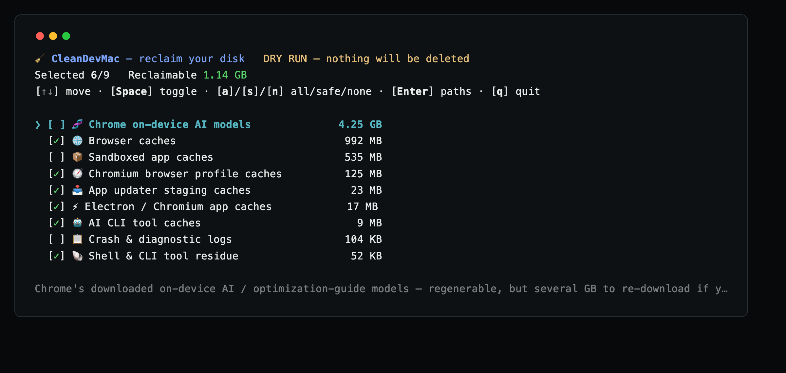

# CleanDevMac

[English](README.md) | [العربية](README.ar.md) | [Español](README.es.md) | [日本語](README.ja.md) | [简体中文](README.zh-CN.md) | 繁體中文

[](https://github.com/cleandevmac/cdm/releases)
[](https://github.com/cleandevmac/cdm/releases/latest)
[](https://github.com/cleandevmac/cdm/stargazers)
[](LICENSE)
[](https://github.com/cleandevmac/cdm)
[](https://www.paypal.com/paypalme/hoangnc)

**CleanDevMac**（在命令列上就是 `cdm`）是一個終端機介面工具：它找出正在吃掉你磁碟的開發快取、建置產物與應用程式殘留資料，清楚列出它們是什麼、佔了多大，然後只刪除你勾選的項目。

下載徽章統計的是 `cdm` 這個發行資源的抓取次數。底下每一行 `curl` 都會請求該資源，因此它就是這個工具真正的使用計數。

網站：**<https://cleandevmac.github.io>**

僅支援 macOS。純 bash，沒有相依套件。零遙測——`cdm` 唯一會發出的網路請求，就是取得它自己的規則 JSON。（清理後按 `b` 會在瀏覽器開啟贊助連結；不會向任何地方送出任何資料。）

## 執行

```bash
curl -sSL https://github.com/cleandevmac/cdm/releases/latest/download/cdm | bash
```

沒有安裝步驟。指令稿直接從管線執行、掃描，然後把 TUI 交給你。結束之後，它不會在你的 Mac 上留下任何東西。

建議先跑一次試執行：只掃描並回報，不刪除任何東西。

```bash
curl -sSL https://github.com/cleandevmac/cdm/releases/latest/download/cdm | bash -s -- -n
```

## 留在本機（選用）

只有在你想不帶 URL 再次執行 `cdm` 時才需要這麼做。這是這裡唯一會留下檔案的做法：

```bash
mkdir -p ~/.local/bin
curl -sSL https://github.com/cleandevmac/cdm/releases/latest/download/cdm -o ~/.local/bin/cdm
chmod +x ~/.local/bin/cdm
cdm
```

請確認 `~/.local/bin` 有在你的 `PATH` 裡（在 shell 的 rc 檔中加入 `export PATH="$HOME/.local/bin:$PATH"`）。重新執行 `curl -o` 那一行即可更新。解除安裝：`rm ~/.local/bin/cdm`。



## 它會清理什麼

**1. 開發快取與建置產物** — Xcode 的 DerivedData 與 DeviceSupport、Go 的建置與模組快取、npm/npx/pnpm/yarn、JS 建置工具（Turbo、Vite、webpack、Parcel、ESLint）、Gradle、Maven、sbt/Ivy、Cargo、Python（pip、uv、poetry、ruff、mypy）、Ruby/Bundler、Bun、Deno、CocoaPods、SwiftPM、Composer、Bazel、Zig、雲端 CLI（kubectl、AWS、gcloud、Azure）、Docker buildx、JetBrains、Playwright、Homebrew 與 PlatformIO 的下載快取、Android Studio 快取與模擬器快照，以及已不再被任何 AVD 使用的 Android 系統映像檔。

**2. 會重新下載的已安裝 SDK 元件** — 全部需要自行勾選，每一列都寫明它如何回來：PlatformIO 已安裝的平台與工具鏈（下一次 `pio run` 會下載需要的部分）；Android NDK、CMake 與 SDK 原始碼；除最新版以外的所有 Android build-tools 與平台版本；60 天內沒人啟動過的 AVD 的系統映像檔（該列會列出 AVD 名稱，重新安裝映像檔之前該 AVD 無法啟動）；以及預設與 stable 以外的每個 Rust 工具鏈，以 `rustup toolchain uninstall` 移除（該列會列出固定使用它的儲存庫）。`sdkmanager`、`adb`、模擬器以及 PlatformIO 自己的 `pio` 永遠不會被列出。

**3. 舊的 Claude Code 對話紀錄** — 需要自行勾選：30 天沒動過的工作階段，連同其子代理與工具輸出檔案，會移到垃圾桶。執行中的工作階段、自動記憶與設定永遠不會被動到。歷史紀錄很大時，`cdm` 還會印出 `~/.claude/settings.json` 該加的鍵（`desktopSessionCleanupPeriodDays`）：加上之後，Claude Code 會自行刪除過期的 Desktop 與 Cowork 工作階段。`cdm` 從不修改那個檔案。

**4. Electron、瀏覽器與應用程式快取** — VS Code、Claude（包括每個預覽的 webview 快取，以及可選的 Cowork 虛擬機器映像檔）、Slack；Chrome、Brave、Edge、Vivaldi 與 Arc 會依瀏覽器設定檔分別掃描；Firefox；以及當機／遙測 SDK 的快取（Sentry、Crashlytics、Sparkle）。

**5. 專案垃圾，依儲存庫分組** — `node_modules`、`dist`、`build`、`target`、`__pycache__`，以及被 git 忽略的檔案。只會是儲存庫自己用 git 忽略的內容。預設關閉，加上 `-p` 才會啟用。互動式執行時，會在快取掃描結束後主動詢問你。

**6. Docker / Podman** — `system prune -af`，以及對每個 buildx builder 的快取執行 `buildx prune -af`（已停止的 builder 會為此啟動，完成後再停止），需自行選擇啟用。具名磁碟區永遠不會被刪除。

**7. 殘留的應用程式資料** — 屬於那些已經不再安裝的應用程式的 Application Support、Caches 與 Preferences，以及一些應用程式以自己名稱保存的資料夾：VS Code 的 `~/.vscode` 與 `Application Support/Code`、Cursor、Zed、Docker Desktop、Postman、Slack、JetBrains IDE、Android Studio 等，列在 `orphans.json` 中。命令列工具也會用到的資料夾（`~/.docker`、`~/.ollama`、`~/.codex`、`~/.android`、`~/.cursor`）以及 Docker Desktop 的虛擬機磁碟，會單獨放在一列 **(optional)** 中，並說明何時應該保留；只要使用它的命令（`docker`、`ollama`、`codex`、`adb` 等）還在 PATH 中，共用資料夾就不會出現。

**重新開機能釋放多少空間。** 交換空間（swap）、macOS 開機時清空的暫存資料夾，以及仍被應用程式開啟著的已刪除檔案，都不是任何清理工具能刪除的檔案；磁碟快滿時，它們加起來可能有數十 GB。當它們超過剩餘空間時，`cdm` 會在磁碟那一行下方說明，並在選單中再顯示一次，同時列出仍開啟著已刪除檔案的應用程式：結束這些應用程式，不必重新開機就能釋放這一部分。

## 安全性

- **沒有逐項確認，就不會刪除任何東西。** 你會先看到計畫與大小，然後輸入 `y`。
- **快取會被永久刪除**——它們會在下次建置時重新產生。
- **殘留的應用程式資料、被 git 忽略的檔案以及舊的 Claude Code 對話紀錄會移到垃圾桶**，因此可以救回。
- **凡是會移除已安裝軟體的項目都預設不勾選**——SDK 元件、工具鏈、模擬器映像檔——且每一列都寫明如何回來。Rust 工具鏈由 `rustup` 移除，從不使用 `rm`。
- **無論規則怎麼寫都絕不碰的位置：** `~/Documents`、`~/Desktop`、`~/Downloads`、`~/Pictures`、`~/.ssh` 與 iCloud 雲碟。這道防線位在規則引擎之下，規則無法繞過它。
- **只有被儲存庫 git 忽略的資料夾才算專案垃圾。** 只符合 `dist`、`build` 或 `Pods` 這類名稱並不夠——cdm 會用 git 確認該目錄既被忽略*又*未被追蹤，因此存放發佈腳本、受版本控制的 `build/`，或已提交的 `dist/`，都會原封不動。
- **`.env*` 檔案永遠不會被列入刪除。** 即使被 git 忽略，專案掃描也會跳過它們——裡面放的是無法重新產生的密鑰與本機設定。
- **應用程式沙箱以及屬於 Apple 或系統的資料永遠不會被動到。** 唯一的例外是已解除安裝的 Docker Desktop 的容器（存放其虛擬機磁碟），它只出現在預設不勾選的 (optional) 列中。
- 已安裝應用程式的清單讀取自 **LaunchServices**，因此 prefPane、外掛等非 `.app` 套件不會被誤判為殘留。放在垃圾桶裡的應用程式，或 LaunchServices 回報已不在磁碟上的應用程式，都算作已解除安裝。
- `--dry-run` 不會刪除任何東西。
- 每一次執行都會記錄到 `~/.cleandevmac/clean.log`。

## TUI 按鍵

`cdm` 會在掃描前顯示磁碟狀況——總容量、已用、可用；掃描結束後顯示最多能回收多少；清理之後再顯示一次磁碟目前的狀況。

| 按鍵 | 動作 |
| --- | --- |
| `↑` / `↓`、`k` / `j` | 移動 |
| `Space` | 切換目前項目的勾選狀態 |
| `a` / `s` / `n` | 全選／安全預設／全不選 |
| `Enter`（或 `d`） | 顯示某個項目背後確切的路徑與大小 |
| `c` | 清理——產生逐項計畫，按 `y` 確認 |
| `q`（或 `Esc`） | 離開 |

清理完成後會列出結果，並詢問下一步：`r` 重新掃描 · `b` 請我喝杯咖啡 · `q` 離開（預設——按 Enter 或其他任何鍵同樣是離開）。

項目依佔用大小由大到小排列。可安全重新產生的快取會預先勾選；Maven 儲存庫、Playwright 瀏覽器、當機記錄、已安裝的 SDK 元件、舊的 Claude Code 對話紀錄、專案資料夾與殘留的應用程式資料一開始都不勾選——按 `s` 會重設回這組預設選擇。

## 可編輯的規則

清理目標寫在 `rules/` 底下的 JSON 裡，而不是程式碼裡。要增減路徑，只要編輯這些檔案：

| 檔案 | 內容 |
| --- | --- |
| `index.json` | 清單——載入哪些規則檔，以及載入順序 |
| `dev-caches.json` | 開發快取與建置產物 |
| `app-caches.json` | Electron、瀏覽器與應用程式快取 |
| `containers.json` | Docker / Podman |
| `project-junk.json` | 依儲存庫歸類的專案垃圾 |
| `orphans.json` | 殘留應用程式資料的偵測 |

每個分類都是一個物件，包含 `icon`、`name`、`desc`、`paths`、`default`（是否預先勾選）與 `method`（`rm` 代表刪除，`trash` 代表移到垃圾桶）。用 `--patterns <目錄或 URL>` 就能讓 `cdm` 改用你自己的規則集。

分類也可以帶 `procs`——執行時會改寫這些快取的應用程式的程序名稱（`"procs": ["Google Chrome", "Code"]`）。`cdm` 會在請你確認之前列出其中正在執行的應用程式，因為在應用程式執行時清除它的快取，空間馬上又會被佔回去。名稱必須與 `pgrep -x` 完全相符。

少數分類設有 `kind`，由腳本算出要列出的內容：`android-images`（沒有任何 AVD 啟動的系統映像檔）、`android-idle-images`（只有閒置達 `idleDays` 的 AVD 會啟動的映像檔）、`older-versions`（每個 glob 是一組版本，列出最新版以外的全部）、`rust-toolchains`（預設與 stable 以外的工具鏈）以及 `claude-transcripts`（`idleDays` 內沒動過的工作階段，一律移到垃圾桶）。它們從 `images` 或 `candidates` 讀取 glob，從不讀 `paths`，因此不認得該 kind 的舊版 `cdm` 什麼也不會列出。

## 選項

| 選項 | 作用 |
| --- | --- |
| `-n`, `--dry-run` | 掃描並回報；不刪除任何東西 |
| `-y`, `--yes` | 非互動模式：清理預先勾選的安全快取後結束。絕不碰專案資料夾、殘留應用程式資料或垃圾桶 |
| `-p`, `--projects` | 一併掃描程式碼儲存庫中的專案垃圾 |
| `--patterns SRC` | 從本機目錄或基底 URL 載入規則 |
| `--no-color` | 關閉 ANSI 色彩 |
| `-h`, `--help` | 用法 |

## 環境變數

| 變數 | 作用 |
| --- | --- |
| `CDM_REMOTE` | 找不到本機副本時，用來取得規則的基底 URL |
| `CDM_PATTERNS` | 規則來源——本機目錄或基底 URL（等同 `--patterns`） |

## 支持

cdm 是免費的 MIT 專案，而且會一直如此——沒有付費版、沒有遙測，也不會有所保留。如果它幫你把磁碟空間要了回來，而你想請我喝杯咖啡：

**[paypal.me/hoangnc](https://www.paypal.com/paypalme/hoangnc)**

給儲存庫按個星星，或把它介紹給另一位開發者，同樣很有幫助。

## 致謝

部分快取位置有與其他開源的 macOS 清理工具交叉核對：

- [PureMac](https://github.com/momenbasel/PureMac) — MIT
- [mac-cleaner-cli](https://github.com/guhcostan/mac-cleaner-cli) — MIT
- [mac-cleanup-go](https://github.com/2ykwang/mac-cleanup-go) — MIT
- [mac-cleanup-py](https://github.com/mac-cleanup/mac-cleanup-py) — Apache-2.0

這裡的規則是針對本工具自己的 schema 獨立撰寫的，每一條路徑在加入前都經過驗證。

## 授權

MIT — 請見 [LICENSE](LICENSE)。
